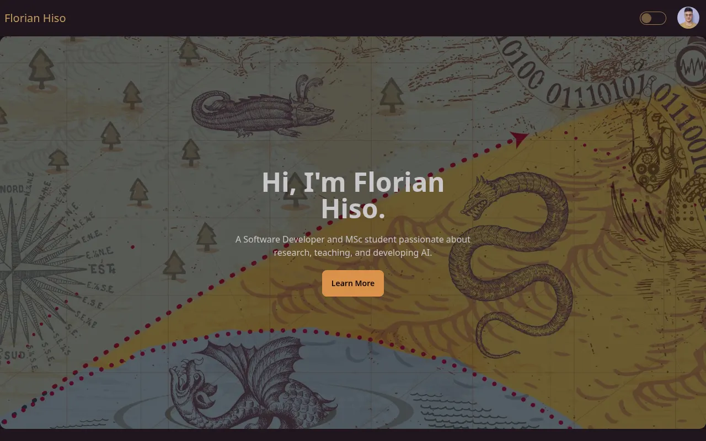

# Florian Hiso

A portfolio site for Florian Hiso: his academic work, a career timeline, skill badges, and project and blog posts loaded from a small Postgres-backed API.

**Status:** retired. Florian now runs his own site, so this one is no longer hosted; the code stays here as a reference. The screenshot below shows it live.



## Features

- Hero, academic-work and stats sections
- Timeline, skill badges, projects and blogs fetched from the API
- Single project and blog pages at `/projects/:id` and `/blogs/:id`
- Light and dark themes (daisyUI `lemonade` and `coffee`) with `theme-change`
- An `/admin` login page (UI only, not wired to the API)

## Stack

- Front end: [React 18](https://react.dev), TypeScript, [Vite](https://vite.dev), [React Router](https://reactrouter.com), [Tailwind CSS](https://tailwindcss.com) with [daisyUI](https://daisyui.com)
- API: Node.js and [Express](https://expressjs.com) with [`pg`](https://node-postgres.com)
- Database: PostgreSQL (schema and data dump in `api/apiSql.sql`)

## Project structure

```
florianHiso/
├── florian-hiso/          # React + TypeScript front end
│   └── src/{pages,components,helper}
└── api/
    ├── index.js           # Express app: GET /getAllData, POST /singlePost/:type
    ├── queries.js         # Postgres queries
    └── apiSql.sql         # tables: badges, blogs, projects, timeline
```

Tags on projects and blogs are stored as JSON of `name: daisyUI badge class`, e.g. `{"NLP": "badge-info"}`. The ERD is in `florian-hiso/public/ERD.PNG`.

## Run locally

Requires Node 18+ and PostgreSQL.

**Database:**

```sh
createdb api
psql -d api -f api/apiSql.sql
```

**API** (port 3000):

```sh
cd api
npm install
npm run dev
```

API environment variables (names only): `NODE_ENV`; in development `DB_USER`, `DB_HOST`, `DB_NAME`, `DB_PASSWORD`, `DB_PORT`; in production `DATABASE_URL`.

**Front end** (port 5173):

```sh
cd florian-hiso
npm install
npm run dev
```

Front-end environment variables (names only): `VITE_DEV_API` and `VITE_PROD_API`, the API base URL for dev and production builds.

## Deploy

- Front end: `npm run build` in `florian-hiso/` and deploy `dist/` to a static host (it is on Netlify; see `netlify.toml`).
- API: any Node host with a Postgres database (it was on Render). Back up with `pg_dump --no-owner -d <db> > apiSql.sql` and restore with `psql -f`.

## License

[Apache 2.0](LICENSE)
